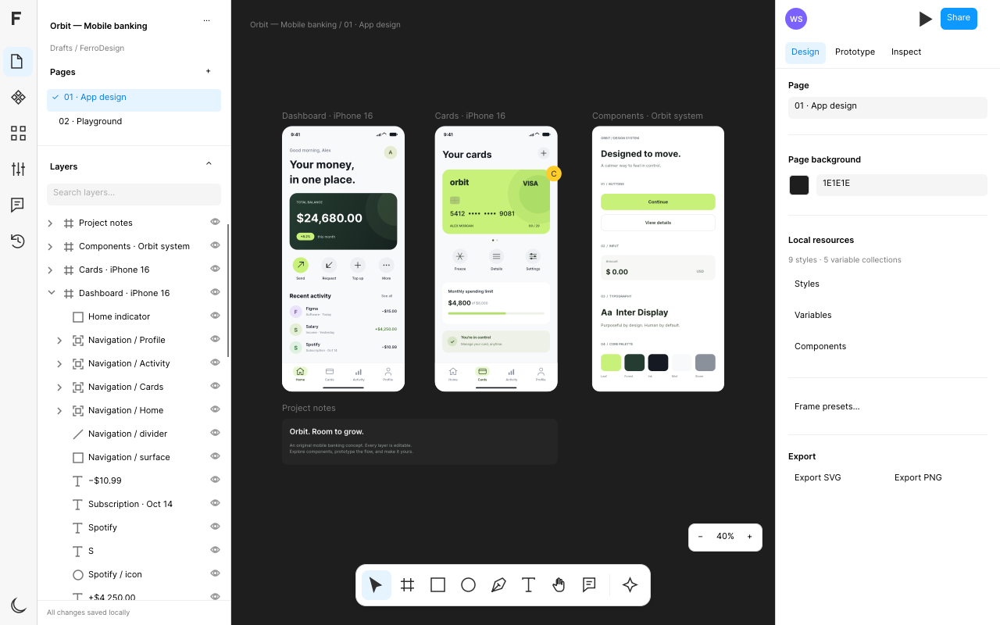

# FerroDesign

FerroDesign is a native design editor built with [FerroUI](https://github.com/wieslawsoltes/FerroUI), a
Rust UI framework, with compiled XAML and the FerroUI Vello backend. It runs on the desktop and in the
browser (WebAssembly): the same editor, controls, document model and scene renderer in both.

**Open it in the browser:** https://ferroui.github.io/FerroDesign/



The editor has pages and layers, an infinite canvas, layout guides, editable vector networks, rich text
with paragraph formatting, image cropping, effects and masks, continuous corners, variable-width
strokes, auto-layout, components with variants, local variables, prototypes, comments, undo and redo,
and portable export. Its feature coverage and limits are in [docs/FEATURES.md](docs/FEATURES.md), and
the complete guide to editing, persistence, validation and rendering performance is in
[docs/GUIDE.md](docs/GUIDE.md). FerroDesign is not an official Figma product and does not claim complete
Figma compatibility.

The editor is FerroUI UI: `Editor.xaml` compiles into FerroUI controls, the canvas is a `Control`, and
artwork is drawn through the public `DrawingContext`, geometry, brush, pen, text and imaging APIs. The
HTML host page only starts WebAssembly and provides browser storage, clipboard and downloads.

## Repository layout

| Path | Content |
|---|---|
| `crates/ferrodesign-core/` | the renderer-independent document, geometry, editing and layout engine |
| `crates/ferrodesign-app/` | the editor: compiled XAML shell, canvas, renderer, platform services; its host page is in `wwwroot/` |
| `tests/` | browser validation scenarios (Playwright) and the script tests of the host page |
| `scripts/` | the browser build, the renderer graph check and the browser validation runner |
| `docs/` | the guide, feature and design notes, and the validation evidence of the former FerroUI branch |
| `FerroUI/` | FerroUI as a git submodule; the editor builds against its crates |

The repository follows the layout of FerroUI applications described in
[FerroUI/docs/apps.md](https://github.com/wieslawsoltes/FerroUI/blob/main/docs/apps.md): the workspace
dependencies and profiles of `Cargo.toml` are kept in step with the submodule by
`FerroUI/scripts/apps/sync-workspace.py`, and the CI is FerroUI's shared application workflow. The
framework changes the editor needed (FerroUI pull request 358) are part of FerroUI main.

## Native launcher

```sh
git clone --recurse-submodules https://github.com/FerroUI/FerroDesign.git
cd FerroDesign
cargo run --locked --profile fast-release -p ferrodesign-app
cargo run --locked -p ferrodesign-app -- --software                         # Vello CPU
cargo run --locked -p ferrodesign-app -- --render-smoke /tmp/ferrodesign.png  # headless frame
```

Rust 1.99 or newer is required, with the platform prerequisites of FerroUI (on Linux a C++ toolchain,
`pkg-config`, and the Fontconfig and FreeType development packages). The launcher uses Vello hybrid
with Metal on macOS, GLX on Linux/X11 and WGL on Windows, each with a Vello CPU fallback.

## Browser

```sh
FerroUI/scripts/browser/setup.sh ~/browser-tools
source ~/browser-tools/env.sh
scripts/build-browser.sh
python3 -m http.server 8080 --directory target/browser/ferrodesign-app
```

The module draws with Vello alone: the build stops when Skia enters the dependency graph of the
browser target (`scripts/check-renderer.sh`). The page requests Vello hybrid on WebGL2 and falls back to
Vello CPU with Software2D presentation; `?RenderingMode=Software2D` or `?RenderingMode=WebGL2` requests
one surface exactly.

## Test

```sh
cargo test --locked -p ferrodesign-core
cargo test --locked -p ferrodesign-app --lib -- --test-threads=1
node --test tests/*.test.mjs
```

The browser validation scenarios drive the built site in Chromium with Playwright
(`npm ci && node tests/browser.mjs`, see `scripts/browser_ci.py` for the groups); they are not part of CI.

## License

MIT, see [LICENSE](LICENSE). The embedded fonts keep their own licenses, see [NOTICE.md](NOTICE.md).
